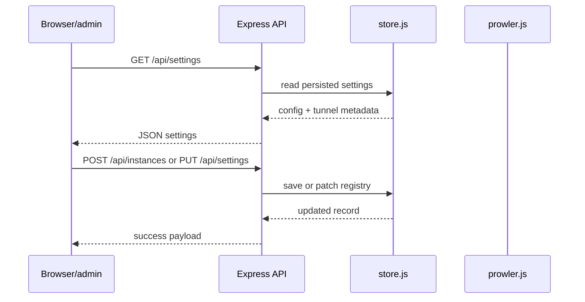
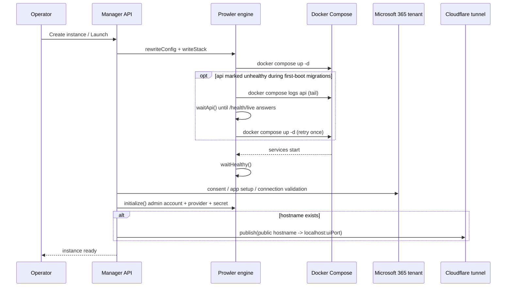
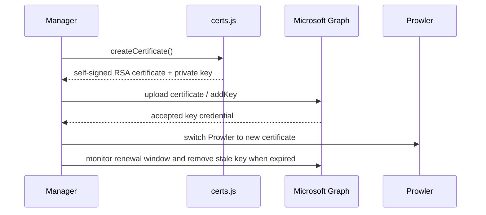
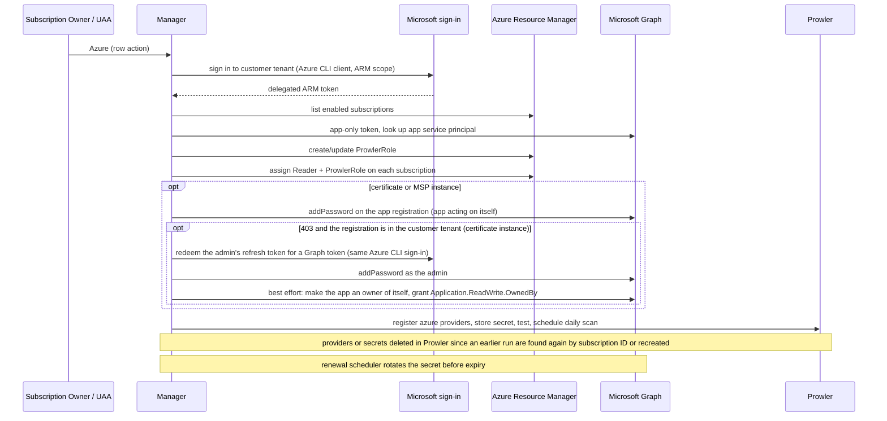
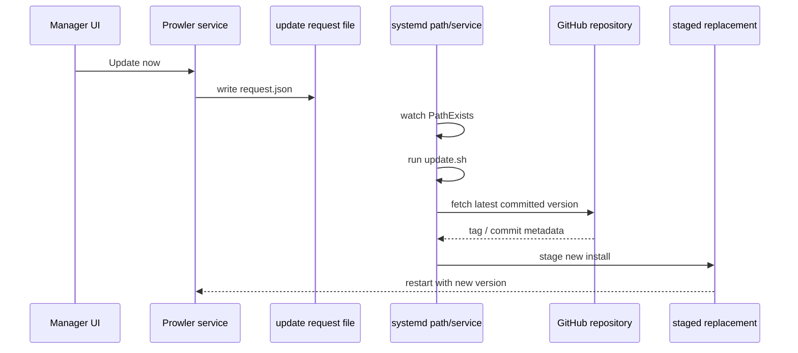

# Application Flow

This document tracks the major runtime flows implemented in the codebase.

## 1. Manager startup and API bootstrap
The Express app is created in [src/server.js](../src/server.js) and starts with the selected host and port. It binds static assets from [public/](../public), serves the dashboard, and defines routes for settings and instance operations. The OAuth callback path is also mounted here so Microsoft sign-in can redirect back into the manager.



## 2. Creating and launching an instance
The instance flow is orchestrated in the `launch` function in [src/server.js](../src/server.js). It prepares bootstrap material for certificate-based auth, rewrites the instance environment, runs Docker Compose, waits for health endpoints, ensures consent or certificate readiness, initializes Prowler, and then publishes the instance through Cloudflare if a hostname is configured.



## 3. Certificate bootstrap and renewal
Certificate generation and Graph operations are in [src/certs.js](../src/certs.js), while the renewal logic is in [src/renewal.js](../src/renewal.js). The sequence below describes the standard certificate lifecycle:



## 4. Tenant onboarding and consent flow
The onboarding flow is implemented in [src/onboarding.js](../src/onboarding.js) and [src/msp.js](../src/msp.js). It supports direct app creation, MSP app flows, and device-code fallbacks when the Graph Command Line Tools public client is used.

```mermaid
sequenceDiagram
    participant Admin as Privileged Role Admin
    participant Manager as Manager
    participant MS as Microsoft sign-in
    participant Graph as Entra Graph

    Admin->>Manager: choose tenant onboarding mode
    Manager->>MS: start sign-in / consent
    MS-->>Manager: callback + tenant context
    Manager->>Graph: create app or enterprise app relationship
    Manager->>Graph: assign Global Reader (admin's own token; MSP: Graph CLI client, no delegated grant to the MSP app)
    opt re-approving an existing MSP instance
        Manager->>Graph: delete delegated grants older versions left for the MSP app
    end
    Manager-->>Admin: proceed to instance launch
```

**Recreating a deleted app registration.** If the dedicated app registration of a certificate instance is deleted in Entra ID, the app's own sign-in fails with `AADSTS700016`. The **Azure** dialog checks for this first (`GET /api/instances/:id/app-status`), and so does a failed Azure sign-in. When the app is missing, the dialog says so and offers **Create new app registration**. Nothing is created until the user clicks that button. The click starts the `direct` flow with the instance's ID. The server checks again that the app is really missing, and the sign-in must be to the instance's tenant. The flow then creates a new app registration (same permissions, new certificate, self-ownership, Global Reader) and runs admin consent. After that the instance switches to the new client ID and certificate, and Prowler's M365 provider secret is updated, or on the next Launch if Prowler is down. The old Azure client secret record is dropped because it belonged to the deleted app. Running **Azure** again assigns roles to the new service principal and updates the Azure providers in Prowler.

```mermaid
sequenceDiagram
    participant Admin as Privileged Role Admin
    participant UI as Manager UI
    participant Manager as Manager
    participant Graph as Entra Graph
    participant P as Prowler

    Admin->>UI: Azure (row action)
    UI->>Manager: GET /api/instances/:id/app-status
    Manager->>Graph: app-only token with the instance certificate
    Graph-->>Manager: AADSTS700016 (app not found)
    UI-->>Admin: "App registration missing. Create a new one?"
    Admin->>UI: Create new app registration (confirm)
    UI->>Manager: direct sign-in with instanceId
    Manager->>Graph: create app + SP, owner of itself, Global Reader, admin consent
    Manager->>Manager: instance.clientId / cert = new app; azure.appSecret = null
    Manager->>P: update M365 provider secret (or on next Launch)
    UI-->>Admin: back to "Sign in to Azure"
```

## 5. Azure subscription onboarding
The **Azure** row action is implemented in [src/azure.js](../src/azure.js), started through the `azure` sign-in kind in [src/onboarding.js](../src/onboarding.js).



## 6. Update flow
The self-update mechanism is represented by [src/updater.js](../src/updater.js) and the root-owned systemd units in [deploy/prowler-manage-update.path](../deploy/prowler-manage-update.path) and [deploy/prowler-manage-update.service](../deploy/prowler-manage-update.service). The logic is designed to avoid in-place mutation while the service is running and to switch to a staged replacement when the update succeeds.


