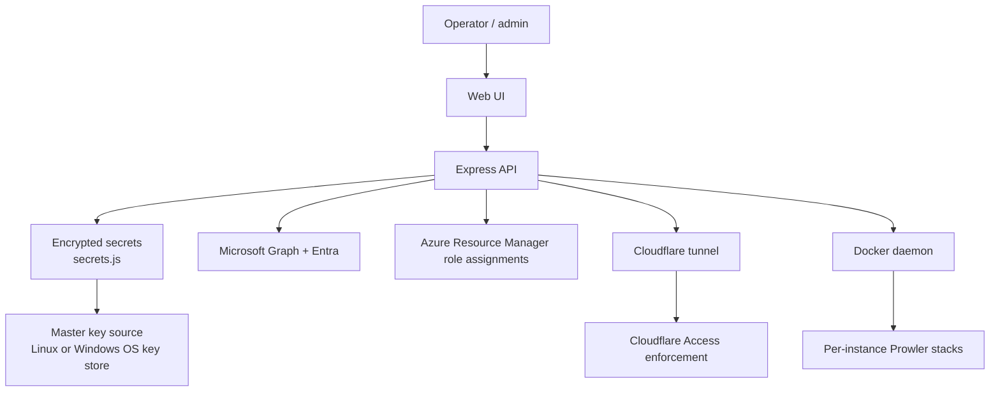

# Security Architecture

The codebase reflects a security-first operational mindset. The principal controls are key protection, service hardening, Cloudflare access enforcement, and least-privilege identity flows.

## Key protection

At-rest key protection is implemented in [src/secrets.js](../src/secrets.js). On Linux, the project uses AES-256-GCM with a 32-byte master key; on Windows, it relies on DPAPI for the active user account. This is confirmed by the certificate sealing logic in [src/certs.js](../src/certs.js).

The README explicitly documents the key source precedence in Linux: systemd credentials, root-only file, service-user-readable file, and the development fallback in `data/master.key`. This is described in [README.md](../README.md).

## Service hardening

The service unit in [deploy/prowler-manage.service](../deploy/prowler-manage.service) disables several system-level privileges and isolates the process. It runs under a dedicated service user, restricts file access, uses `ProtectSystem=strict`, and sets `PrivateTmp=true`, `ProtectHome=true`, and `NoNewPrivileges=true`.

## Tenant access model

The manager supports different tenant connection models in [src/server.js](../src/server.js), [src/onboarding.js](../src/onboarding.js), and [src/msp.js](../src/msp.js):

- MSP app model;
- dedicated customer app; 
- existing app registration.

Each mode is designed to require explicit consent and to assign roles such as Global Reader only after approval. If a dedicated app registration is deleted in Entra ID, the manager never recreates it silently. The Azure dialog reports the missing app, and a new registration is created only after the user confirms and a Privileged Role Administrator signs in to that tenant (the same `direct` flow and permissions as first-time setup). The server checks that the old app really is gone (`AADSTS700016`) before it starts. Role assignments the deleted service principal held on Azure subscriptions stay behind as "Identity not found" entries; remove them under Access control (IAM). Default patterns are described in [README.md](../README.md).

Least privilege (full table in the README's *Least privilege* section):

- The Prowler app is never assigned Global Administrator or any directory role that can change configuration. It holds Prowler's documented read-only Graph application permissions, `Exchange.ManageAsApp`, Teams `application_access`, the **Global Reader** directory role (required by Prowler's Exchange and Teams checks) and, for credential self-renewal only, `Application.ReadWrite.OwnedBy` (scoped to its own registration; for the MSP app only in the MSP tenant).
- The MSP app declares **no delegated permissions**. The "Approve now" step that assigns Global Reader uses Microsoft's Graph Command Line Tools public client with the signing-in admin's own short-lived token (`RoleManagement.ReadWrite.Directory`), so no customer tenant holds a standing delegated grant for the MSP app. When an existing instance is re-approved, that sign-in also requests `DelegatedPermissionGrant.ReadWrite.All` and deletes any delegated grant an older version left for the MSP app.
- The admins who sign in need Privileged Role Administrator, not Global Administrator. It is the least-privileged role that can grant Microsoft Graph application permissions and assign Global Reader. Azure onboarding needs User Access Administrator on the subscriptions.

## Azure subscription access

Azure onboarding ([src/azure.js](../src/azure.js)) needs an admin's delegated Azure Resource Manager token with User Access Administrator (or Owner) on the subscriptions. Like the other sign-in tokens, it lives only in memory for the duration of the flow. The app's service principal receives only `Reader` and the custom `ProwlerRole`, which adds two read actions on App Service (`Microsoft.Web/sites/host/listkeys/action`, `Microsoft.Web/sites/config/list/Action`), per Prowler's documented requirements. Those two actions return Function host keys and App Service application settings, which can contain secrets. They are the most sensitive permissions the app holds in Azure, and only four Prowler checks use them. Operators who prefer not to grant them can remove the ProwlerRole assignment and accept that those checks fail.

Prowler's Azure provider only accepts a client secret. For certificate and MSP instances the manager adds a password credential to the app registration through the app's own `Application.ReadWrite.OwnedBy` permission. If the app lacks it and its registration is in the customer tenant (certificate instances), the admin's Azure sign-in (Azure CLI public client) is exchanged once for a delegated Microsoft Graph token. That token adds the password and tries to make the app an owner of itself with `Application.ReadWrite.OwnedBy`, so later renewals run as the app. The admin's refresh token is held in memory only for the length of the flow and is never returned to the browser. MSP instances never use this fallback, because the MSP app lives in the MSP tenant. The secret text goes straight to Prowler and is never written to the manager's disk. Only its key ID and expiry are stored, so it can be rotated before expiry and removed when the instance is deleted. For MSP instances these passwords sit on the shared MSP app, one per instance, so the MSP app's credential list grows with the number of Azure-connected instances. A client secret typed in for a secret-based instance is held in memory only until the flow ends.

## Cloudflare access

The manager uses Cloudflare as an ingress and strongly warns that the service itself is not protected by login unless Cloudflare Access is configured. The app detects Cloudflare headers and surfaces a red warning when the manager is reached without Access. The relevant logic lives in [src/server.js](../src/server.js) and the operational guidance in [README.md](../README.md).

## Security conclusions

This repository deliberately treats the host as a privileged environment. The trust boundary is the machine running the manager, Docker, Cloudflare tunnel, and the master key source. As long as that boundary is controlled, the design is robust for managed multi-tenant operations.

